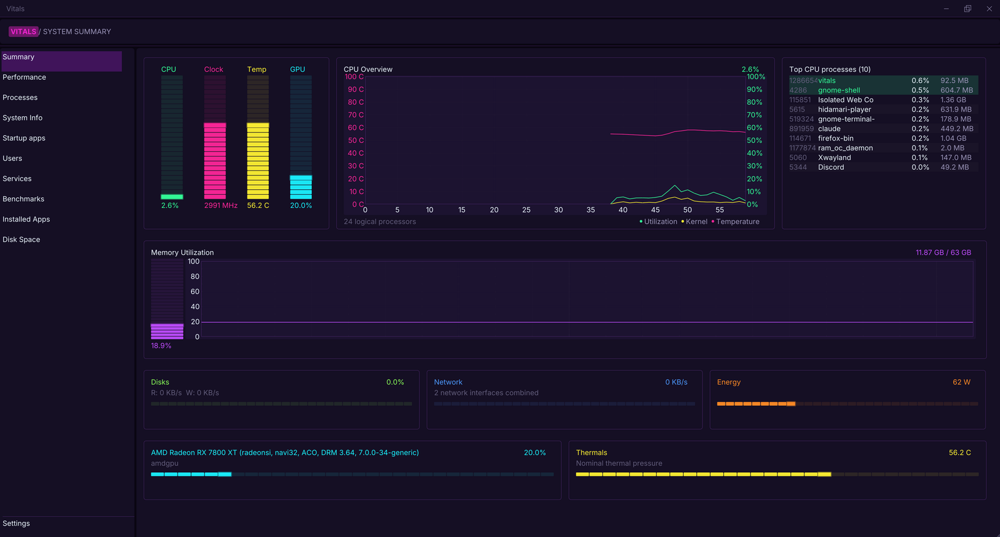
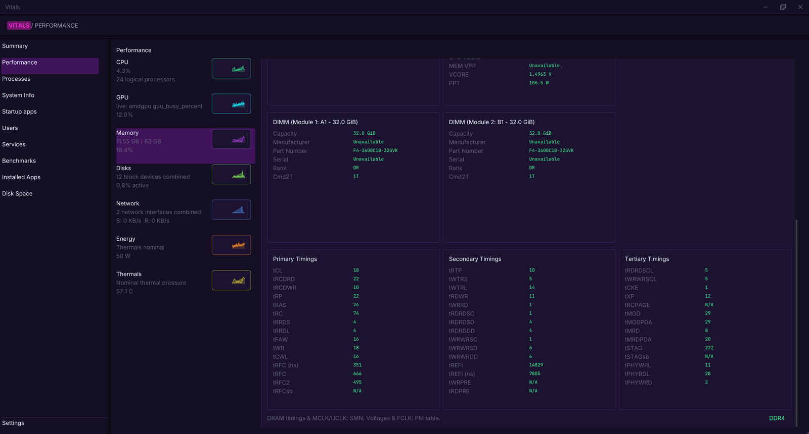
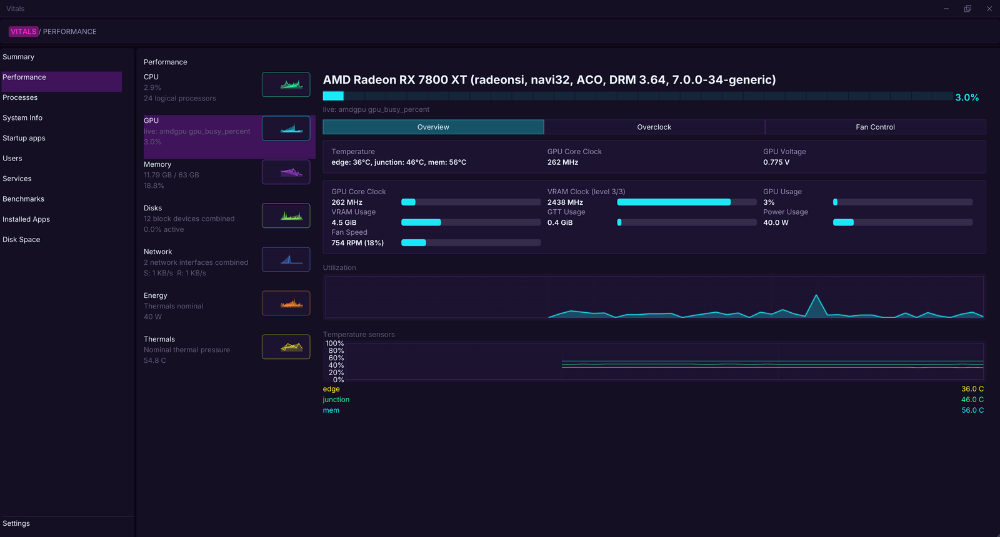
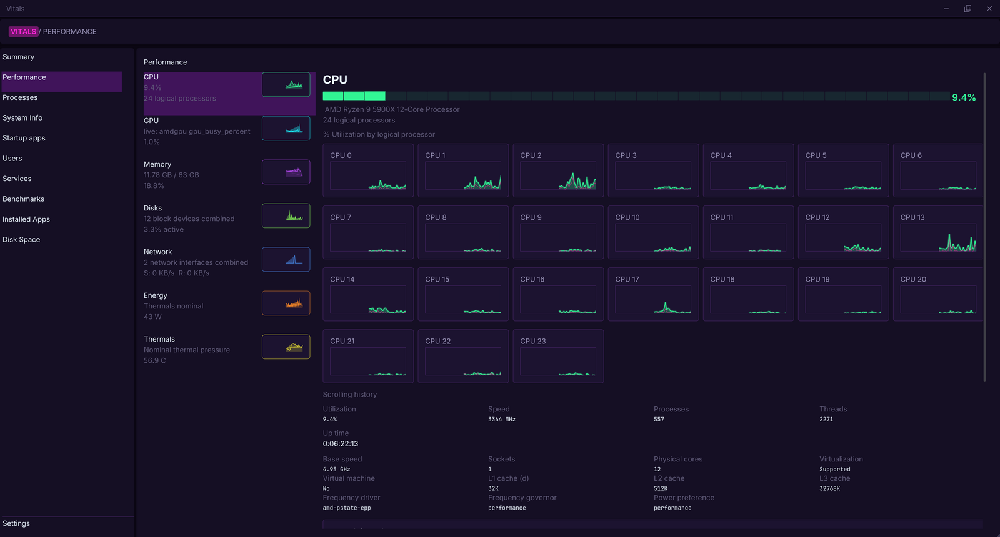
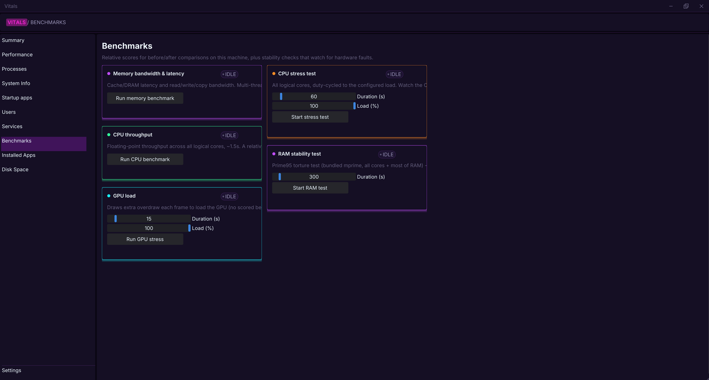
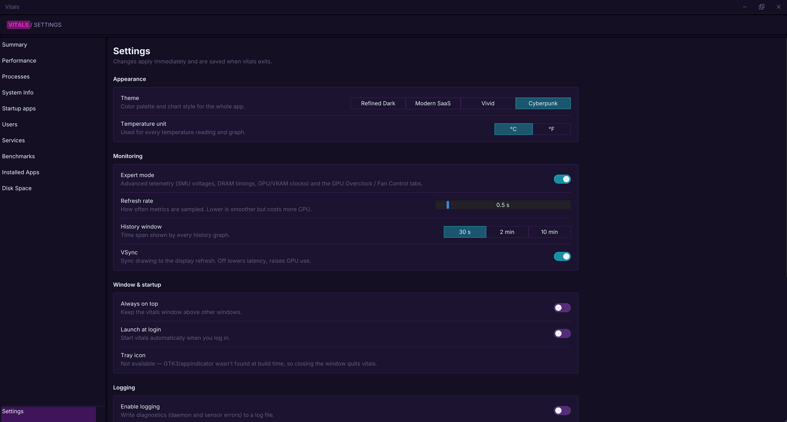

# vitals

A fast, good-looking **system monitor and task manager for Linux** — think Windows Task Manager / HWiNFO — built with Dear ImGui + ImPlot. Out of the box it's a plain, unprivileged task manager. Switch on **Expert mode** for deep CPU/RAM telemetry.



## Features

**Monitoring**
- **Summary** — CPU, clock, temperature, GPU meters, CPU/memory history, top processes, disks, network, energy, thermals at a glance
- **Performance** — detail pages for CPU (per-core), memory, disks, network, energy, thermals and GPU, each with live history graphs
- **Processes** — sortable table with CPU/memory/GPU usage; start / stop / terminate / kill
- **System Info, Users, Services, Startup apps, Installed Apps, Disk Space**
- **Benchmarks** — memory bandwidth & latency, CPU throughput, GPU load, CPU stress test (configurable load and duration), RAM stability test (Prime95)
- Themes (Refined Dark, Modern SaaS, Vivid, Cyberpunk), °C/°F, adjustable refresh rate and history window, tray icon

**Expert mode** (Settings → Monitoring)
- **RAM timings** — the live primary (tCL, tRCD, tRP, tRAS, tRC, tRFC …), secondary (tRTP, tWTR, tRDWR, tWRRD, tREFI …) and tertiary (tRDRDSCL, tWRWRSCL, tCKE, tMOD, tSTAG, tPHY* …) timings straight from the memory controller, plus Cmd2T, GDM and power-down mode — like ZenTimings, on Linux
- DIMM details per slot (capacity, part number, rank) and SPD temperatures
- AMD SMU telemetry: core/SoC/memory voltages, PPT, FCLK/UCLK/MCLK, per-CCD temperatures
- Per-sensor GPU temperature graphs

## Screenshots

### RAM timings (Expert mode)
Primary, secondary and tertiary DRAM timings, DIMM details and SMU voltages, read live from the memory controller.



### GPU overview
Live core/VRAM clocks, VRAM and GTT usage, power, fan speed and all GPU temperatures.



### CPU
Per-core load, clocks and history.



### Benchmarks
Memory bandwidth & latency, CPU throughput, GPU load, CPU stress test and Prime95 RAM stability test.



### Settings
Appearance, monitoring options, startup, logging, and the status and on/off commands for the daemon.



## How it's put together

| Binary | Runs as | Purpose |
|---|---|---|
| `vitals` | your user | The GUI. Never elevates itself or starts anything on its own. |
| `ram_oc_daemon` (`vitals-ramocd` service) | root | DRAM/SMU telemetry and the memory benchmark, over shared memory + a Unix socket. GPLv3, kept as a separate process so `vitals` doesn't link GPL code. |

The daemon is optional.

## Build & Run

### 1. Install build dependencies

Debian / Ubuntu:

```sh
sudo apt install build-essential cmake git pkg-config \
    libgl-dev libx11-dev libxrandr-dev libxinerama-dev libxcursor-dev libxi-dev \
    libwayland-dev libwayland-bin libxkbcommon-dev wayland-protocols

# optional, for the tray icon:
sudo apt install libgtk-3-dev libayatana-appindicator3-dev
```

You need CMake ≥ 3.20, a C++17 compiler and an OpenGL 3.3 driver. GLFW, Dear ImGui, ImPlot and tray are downloaded automatically by CMake on the first build (needs `git` and internet once).

### 2. Build

```sh
git clone <this repo> vitals && cd vitals
cmake -B build -DCMAKE_BUILD_TYPE=Release
cmake --build build -j
```

Result in `build/`: `vitals` (the app) and `ram_oc_daemon` (the optional daemon).

### 3. Run

```sh
./build/vitals
```

That's the complete task manager — no root and no daemons needed.

### 4. Enable the daemon (optional, one time)

For RAM/SMU telemetry and the memory benchmark, install the daemon once. It then starts at every boot until you turn it off:

```sh
sudo scripts/install-daemons.sh             # installs, starts and enables vitals-ramocd
```

Then turn on **Settings → Expert mode**. **Settings → Daemons** shows the daemon's status.

```sh
sudo systemctl disable --now vitals-ramocd  # turn the daemon off ...
sudo systemctl enable  --now vitals-ramocd  # ... and back on
sudo scripts/install-daemons.sh             # after a rebuild: update the installed daemon
```

## Install as .deb packages

### 1. Create the packages

After building (steps 1–2 above):

```sh
cd build
cpack
```

This creates the package in `build/`:

| Package | Contains |
|---|---|
| `vitals_1.0.0_amd64.deb` | the app, desktop entries (normal + "vitals (root)"), icon, fonts, and the `vitals-ramocd` service |

### 2. Install it

```sh
sudo apt install ./vitals_1.0.0_amd64.deb          # app — then start "vitals" from your app menu
```

Use `apt install ./…deb` rather than `dpkg -i`, so dependencies (`pkexec`) are resolved.

### 3. Enable the daemon (one time)

The package installs the service but never starts it by itself:

```sh
sudo systemctl enable --now vitals-ramocd
```

### Update or remove

```sh
# after code changes: rebuild, repackage, reinstall
cmake --build build && (cd build && rm -f *.deb && cpack)
sudo apt install --reinstall ./build/vitals_1.0.0_amd64.deb

# uninstall (the service is stopped and disabled automatically)
sudo apt remove vitals
```

`--reinstall` is needed because the version number doesn't change between rebuilds; bump `CPACK_PACKAGE_VERSION` in `CMakeLists.txt` for normal upgrades instead.

## Notes

- **Running the GUI as root on Wayland:** plain `sudo` strips `XDG_RUNTIME_DIR`/`WAYLAND_DISPLAY` — use `sudo -E ./build/vitals`. (Not needed when the daemon is installed.)
- **SMU voltages / DRAM timings** need the `ryzen_smu` kernel module on AMD Ryzen.
- **DRAM voltage on NCT6687D boards** (many recent MSI/ASUS/Gigabyte): install [`nct6687d`](https://github.com/Fred78290/nct6687d) via DKMS and `sudo modprobe nct6687`; vitals reads its `DRAM` channel directly.
- **VRAM always at its top clock?** With several high-resolution or high-refresh monitors, amdgpu keeps VRAM at its highest level on purpose — not a reading error.

## Third-party software & credits

| Software | Used for | License |
|---|---|---|
| [Dear ImGui](https://github.com/ocornut/imgui) | GUI toolkit | MIT |
| [ImPlot](https://github.com/epezent/implot) | Graphs | MIT |
| [GLFW](https://github.com/glfw/glfw) | Window, OpenGL context, input | zlib |
| [tray](https://github.com/zserge/tray) | System tray icon | MIT |
| **TuxTimings** (vendored in `ram_oc/`) | AMD SMU / PM-table telemetry, DRAM timings, memory benchmark — compiled only into `ram_oc_daemon` | GPLv3 — [`ram_oc/LICENSE`](ram_oc/LICENSE) |
| [Prime95 / mprime](https://www.mersenne.org/) v30.19 (bundled in `oc/`) | RAM stability test | GIMPS license — [`oc/p95v3019b20.linux64/license.txt`](oc/p95v3019b20.linux64/license.txt) |
| [Inter](https://rsms.me/inter/), [JetBrains Mono](https://www.jetbrains.com/lp/mono/) | UI and monospace fonts | SIL OFL 1.1 — [`assets/fonts/`](assets/fonts/) |

Optional system components used when present (not bundled): `ryzen_smu` kernel module, `nct6687d` kernel module, AMD `amdgpu` sysfs interfaces.

## License

**vitals** — © 2026 RedEyeArchangel — is licensed under **[CC BY-NC-SA 4.0](https://creativecommons.org/licenses/by-nc-sa/4.0/)** (Attribution-NonCommercial-ShareAlike). See [`LICENSE`](LICENSE).

Third-party components keep their own licenses (table above). The GPLv3 `ram_oc/` sources are built only into the separate `ram_oc_daemon` executable, which is therefore GPLv3 itself; `vitals` talks to it only over IPC and links no GPL code.
